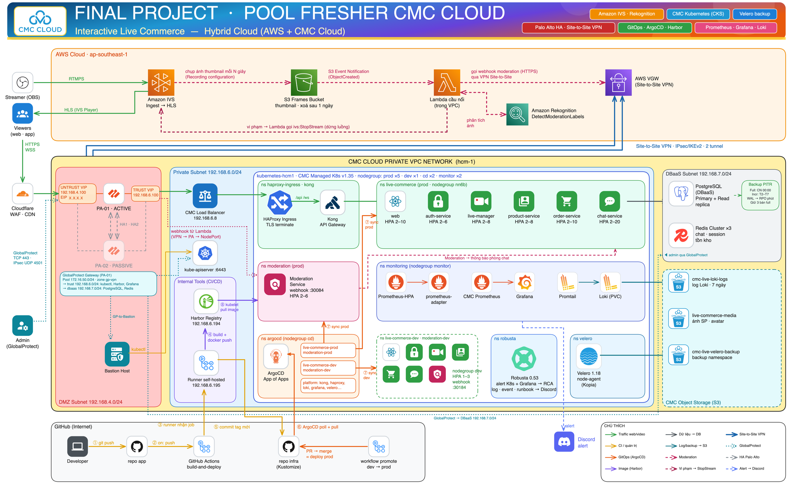
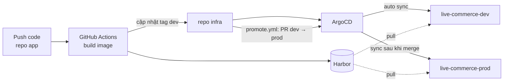

# live-commerce-hybrid-k8s-gitops-observability-dr

> Hạ tầng GitOps cho nền tảng **Interactive Live Commerce** trên Hybrid Cloud: Kubernetes CMC Cloud chạy ứng dụng và dữ liệu, AWS lo livestream (IVS) và kiểm duyệt AI. ArgoCD đọc repo này và đồng bộ mọi thứ vào cluster.

Mã nguồn ứng dụng: [realtime-live-commerce-flashsale-microservices](https://github.com/clgp-aint-cool/realtime-live-commerce-flashsale-microservices)



## Thành phần

| Lớp | Công nghệ |
|---|---|
| GitOps | ArgoCD (App of Apps), Kustomize base + overlay dev/prod, Sealed Secrets |
| Edge | Cloudflare WAF/CDN → Palo Alto VM-Series HA → CMC Load Balancer → HAProxy Ingress → Kong |
| Giám sát | Prometheus, Grafana, Loki + Alloy, cảnh báo Discord, Robusta |
| Tự mở rộng | HPA theo request (prometheus-adapter), CMC node auto-scaling |
| Backup / DR | Velero (Kopia) → CMC Object Storage, DBaaS PostgreSQL PITR |
| Hybrid | Site-to-Site VPN IPsec tới AWS VPC, GlobalProtect cho quản trị |

## Luồng triển khai



## Cấu trúc

```
argocd/      # install, projects, bootstrap (root-app), apps/{platform,workloads}
platform/    # Helm values + manifest: edge, haproxy-ingress, kong, monitoring, velero, sealed-secrets
apps/        # live-commerce, moderation: base + overlays/{dev,prod}
cloud/       # aws/ (CDK), network/ (Palo Alto, VPN)
scripts/     # promote.sh: chép tag dev -> prod
docs/        # argocd, gitops-flow, environments, secrets, object-storage, load-testing
```

## Bắt đầu

1. Thay các placeholder: `grep -R "<ORG>\|harbor.example.local\|<PIN_VERSION>" .`
2. Cài ArgoCD và bootstrap: [argocd/install/README.md](argocd/install/README.md)
3. Tạo secret: [docs/secrets.md](docs/secrets.md)
4. Kiểm tra trước khi push: `make validate` (yamllint + kustomize build + kubeconform)

Triển khai thủ công không qua ArgoCD: [docs/migrate-cmc-k8s.md](docs/migrate-cmc-k8s.md). Thêm: [gitops-flow](docs/gitops-flow.md) · [environments](docs/environments.md) · [load-testing](docs/load-testing.md).
